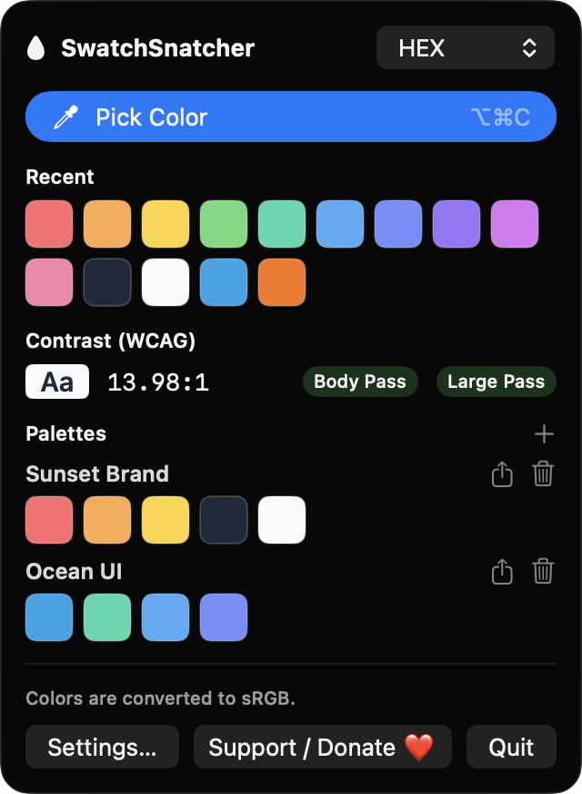
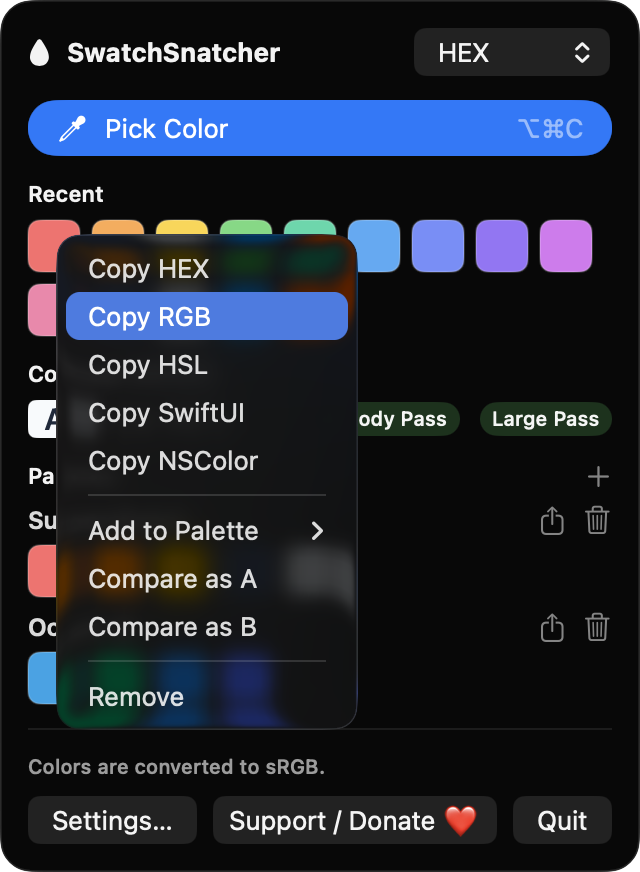
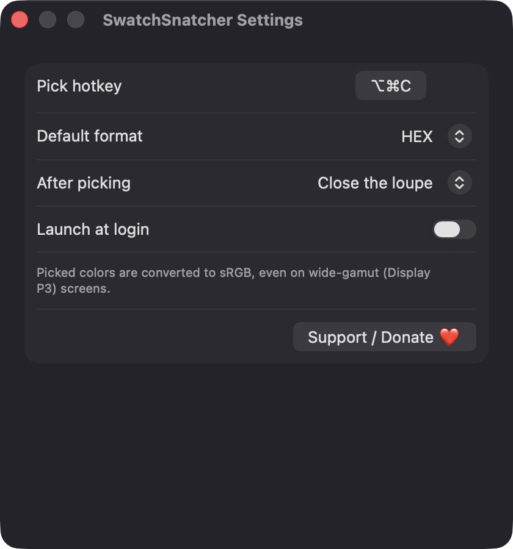

# SwatchSnatcher

**🌐 Website:** [turhe123.github.io/swatch-snatcher](https://turhe123.github.io/swatch-snatcher/)

Pick any color on screen with a magnifier loupe, then copy it as HEX, RGB or SwiftUI code and keep a palette.


## Why

SwatchSnatcher is a free, open-source, 100% native, backend-free alternative to paid utilities in the *Screen & OCR* category. Sip ($9.99 one-time) was the inspiration: a well-loved color picker for designers and developers. SwatchSnatcher covers the core loop (pick, copy, keep) as a small menu bar app written only with Apple frameworks.

## Features

- **Menu bar app** with a drop icon. It has no Dock icon and runs as a popover.
- **Global hotkey** to start picking from anywhere. The default is ⌥⌘C, and you can re-record it in Settings.
- **Magnifier loupe**: a circular, borderless 150 pt window that follows the pointer. It shows a 9×9 grid of magnified pixels, outlines the center pixel and shows its HEX value below. It works across multiple displays with different scale factors.
- **Click to pick, Esc (or right-click) to cancel.** Clicking outside all displays ends the session cleanly.
- **Five copy formats**: HEX, RGB, HSL, a SwiftUI `Color(red:green:blue:)` initializer and an `NSColor(srgbRed:…)` initializer. Pick the default format in the popover or Settings. Right-click any swatch to copy it in a different format.
- **History of the last 50 colors**. Duplicates move to the front. Click a swatch to copy it again and see a checkmark flash.
- **Named palettes**: create, rename and delete palettes, and pin colors from the swatch context menu. Export a palette as a plain text list, one color per line in your default format.
- **WCAG contrast checker**: right-click two swatches and choose *Compare as A / B*. It shows the ratio and Pass/Fail for body text (4.5:1) and large text (3:1).
- **Continuous mode**: stay in the loupe after each pick, or close it after one.
- **Launch at login** through `SMAppService`.
- **sRGB output**: wide-gamut (Display P3) captures are converted to sRGB, and the popover shows the source display's color space.
- **Local storage**: history and palettes are saved as JSON in `~/Library/Application Support/SwatchSnatcher/library.json`.

## Screenshots

<p align="center"></p>

<p align="center"><em>The menu bar popover with recent colors, a WCAG contrast check that passes at 13.98:1, and two named palettes.</em></p>

<p align="center"></p>

<p align="center"><em>Right-click any swatch to copy it as HEX, RGB, HSL, SwiftUI or NSColor, pin it to a palette, or compare it for contrast.</em></p>

<p align="center"></p>

<p align="center"><em>Settings for the global pick hotkey, the default copy format, loupe behavior after picking, and launch at login.</em></p>

## Install

1. Download `SwatchSnatcher-macOS.zip` from the [latest release](https://github.com/turhe123/swatch-snatcher/releases/latest).
2. Unzip it and move `SwatchSnatcher.app` to `/Applications`.
3. The app is open source and not notarized, so clear the quarantine flag:

   ```bash
   xattr -cr /Applications/SwatchSnatcher.app
   ```

4. The first time, right-click the app and choose **Open**.

Requires macOS 14.0 or later.

## Build from source

You need Xcode with the macOS SDK and [XcodeGen](https://github.com/yonaskolb/XcodeGen).

```bash
brew install xcodegen
xcodegen generate
xcodebuild -project SwatchSnatcher.xcodeproj -scheme SwatchSnatcher -configuration Release -derivedDataPath ./build build
```

The app is produced at `build/Build/Products/Release/SwatchSnatcher.app`.

## Permissions

- **Screen Recording** (required): the loupe reads the pixels under the pointer with ScreenCaptureKit. Without this permission the app can't see other apps' pixels. It shows an explanation and an *Open Privacy Settings* button instead of returning black. After you grant it, relaunch the app.
- **Login Items** (optional): only used if you turn on *Launch at login*. macOS may list SwatchSnatcher under System Settings › General › Login Items.

SwatchSnatcher does not request Accessibility, Microphone, Camera, or network access. The global hotkey uses the Carbon `RegisterEventHotKey` API, which needs no extra permission.

## Built with AI

SwatchSnatcher was written by [Claude Code](https://claude.com/claude-code) inside an automated pipeline, from a plain-English spec. No code, binaries or assets from any commercial app were used; it is a clean-room reimplementation of a feature set, not a copy.

What that means in practice:

- The full source is in this repo under the MIT license. Read it before you run it.
- No network calls, no analytics, no third-party dependencies. Only Apple frameworks.
- Ad-hoc signed and not notarized, which is why Gatekeeper warns on first launch.
- It has had less human review than a hand-written app. Bug reports and pull requests are welcome.

## Support ❤️

If SwatchSnatcher saves you time, you can support its development:

[Support Or (Leo) Davidai ❤️](https://ko-fi.com/leodavidai)

The app also has a *Support / Donate ❤️* button in the popover and in Settings.

## License

MIT © Or Davidai Bachar
